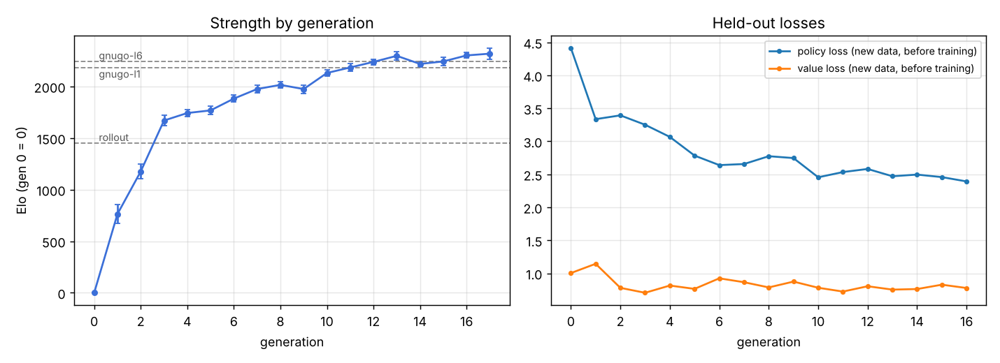

# Gofer

An AlphaZero-style Go engine written in Go, with a PyTorch training loop that
learns 9×9 Go from zero by self-play. Techniques follow
[Wu 2020, *Accelerating Self-Play Learning in Go*](docs/wu-2020-accelerating-self-play.pdf)
(KataGo) at hobby scale: playout-cap randomization, global-pooling residual
network, ownership auxiliary target, Dirichlet root noise.

- **Engine (Go):** incremental bitset board with exact liberties and superko,
  PUCT search with virtual-loss batching, batched multi-core/GPU inference
  through ONNX Runtime, GTP server with live analysis for Sabaki and Lizzie.
- **Training (Python):** self-play shards → augmented training → verified ONNX
  export → evaluation against the previous generation and GNU Go → Elo ladder.
  Resumable, one command.

## Results

Trained from random play on one 4-vCPU cloud VM (no GPU, no human games):
17 generations, 10,200 self-play games, **3.6 hours**.

| Final network (400 visits/move) vs | Games | Score | Elo difference (95% CI) |
|------------------------------------|------:|------:|------------------------:|
| GNU Go 3.8, level 10 (default) | 100 | **66–34** | +115 [+44, +187] |
| GNU Go 3.8, level 1 | 100 | **78–22** | +220 [+138, +301] |
| Gofer v2 engine + its model (400 playouts) — generation 9 at 100 visits | 20 | **20–0** | ≥ +287 |

Games alternate colors over paired random openings; GNU Go judges dead
stones at the end. The v2 engine lost 0–20 to GNU Go level 1.



Per-generation numbers: [docs/results/summary.md](docs/results/summary.md).

## Quick start

```bash
scripts/setup.sh                 # ONNX Runtime, GNU Go, .venv, bin/gofer (add "gpu" on NVIDIA machines)
make test

bin/gofer play -model models/gofer-9x9.onnx            # play in the terminal
bin/gofer gtp  -model models/gofer-9x9.onnx -visits 800 # GTP engine for Sabaki / Lizzie / GoGui
```

In Sabaki: *Engines → Manage engines → Add*, path `bin/gofer`, arguments
`gtp -model models/gofer-9x9.onnx`. Live analysis (`lz-analyze`) works out of
the box.

## Play it in the browser

The landing page in [`web/`](web/) runs the same engine compiled to
WebAssembly, with the network evaluated by onnxruntime-web: watch a game
against GNU Go or play Gofer directly. Rebuild it with `make site`
(Tailwind CSS, `GOOS=js GOARCH=wasm` engine, model copy; outputs are committed
so any static host can serve `web/`), and preview with
`python3 -m http.server -d web 8000`.

## Train your own

```bash
.venv/bin/python -m training.loop --run runs/9x9 --gofer bin/gofer --hours 8
.venv/bin/python -m training.report runs/9x9 --out runs/9x9/report
```

Stop it any time and rerun the same command to resume. See
[docs/training.md](docs/training.md) for the loop, settings, throughput, and
how to use a GPU.

## Commands

| Command | What it does |
|---------|--------------|
| `gofer gtp` | GTP v2 server (`genmove`, `undo`, `final_score`, `lz-analyze`, ...) |
| `gofer play` | Play against the engine in the terminal (`hint` shows its suggestion) |
| `gofer selfplay` | Generate training shards (`.npz`) and SGFs |
| `gofer arena` | Match between two players with Elo, confidence interval and optional SPRT; players are `nn:model.onnx`, `rollout`, `uniform`, `gnugo,level=N` or `gtp:<command>` |
| `gofer bench` | Search and inference throughput |

```bash
bin/gofer arena -a nn:models/gofer-9x9.onnx,visits=400 -b gnugo,level=10 -games 100 -sgf games/
```

## Layout

| Path | |
|------|--|
| `internal/game` | rules, board, scoring |
| `internal/mcts` | search |
| `internal/nn` | features, batched evaluator, ONNX Runtime backend |
| `internal/selfplay`, `internal/arena`, `internal/gtp`, `internal/sgf` | applications |
| `cmd/gofer` | CLI |
| `cmd/gofer-wasm`, `web/` | the engine in WebAssembly and the landing page |
| `training/` | model, data, trainer, export, loop, Elo, report (+ tests) |
| `docs/` | [architecture](docs/architecture.md), [training](docs/training.md), [v2 audit](docs/v2-audit.md) |

## Development

```bash
make lint test race     # gofmt, vet (with and without ONNX), Go + Python tests, race detector
make build-nocgo        # pure-Go binary: rules, search, GTP, arena (no network inference)
```

The board is differential-tested against a naive reference on random games
from 5×5 to 19×19; the search has regression tests for every defect found in
the [v2 audit](docs/v2-audit.md); CI runs a full self-play → train → export →
arena generation against GNU Go.

## Version 3

v3 rewrote the engine core and the training pipeline after an audit found
that v2's search backed up values with the wrong sign, skipped the search on
fresh trees, and trained the policy toward uniform targets, among other
defects. The details, with measurements, are in [docs/v2-audit.md](docs/v2-audit.md).
